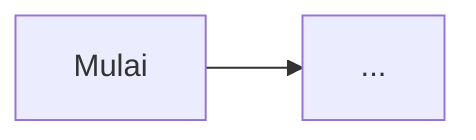

# Template PRD

Gunakan struktur ini untuk `PRD_<nama-proyek>.md`. Hapus bagian yang benar-benar tidak relevan, tetapi jangan menghapus "Di luar scope", "Asumsi", dan "Workflow Pembangunan". Tanda `<...>` diganti dengan isi nyata dari wawancara.

---

````markdown
# PRD — <Nama Proyek>

| Item | Isi |
|------|-----|
| Versi | 0.1 (draft) |
| Tanggal | <tanggal> |
| Penulis | <nama pengguna> |
| Status | Draft |

## 1. Ringkasan
<2–4 kalimat: apa produknya, untuk siapa, masalah apa yang diselesaikan.>

## 2. Latar Belakang & Masalah
- **Masalah:** <...>
- **Kondisi saat ini / alternatif:** <...>
- **Peluang:** <...>

## 3. Tujuan & Metrik Sukses
| Tujuan | Metrik | Target |
|--------|--------|--------|
| <...> | <...> | <angka> |

### Bukan tujuan (Non-goals)
- <...>

## 4. Pengguna & Persona
| Persona | Deskripsi | Kebutuhan utama | Hak akses |
|---------|-----------|-----------------|-----------|
| <...> | <...> | <...> | <...> |

## 5. Scope
### Dalam scope (MVP)
- <...>
### Di luar scope
- <...>
### Rilis berikutnya
- <...>

## 6. Kebutuhan Fungsional
Prioritas: **P0** = wajib MVP, **P1** = penting, **P2** = nice to have.

| ID | Fitur | User story | Acceptance criteria | Prioritas |
|----|-------|-----------|---------------------|-----------|
| F-01 | <...> | Sebagai <peran>, saya ingin <aksi> agar <manfaat> | <kriteria yang bisa diuji> | P0 |

## 7. Alur Pengguna
<Langkah-langkah alur utama; boleh diagram Mermaid.>



## 8. Model Data (Garis Besar)
| Entitas | Atribut utama | Relasi |
|---------|---------------|--------|
| <...> | <...> | <...> |

## 9. Kebutuhan Non-Fungsional
| Kategori | Kebutuhan | Target terukur |
|----------|-----------|----------------|
| Performa | <...> | <...> |
| Keamanan | <...> | <...> |
| Skalabilitas | <...> | <...> |
| Ketersediaan | <...> | <...> |
| Aksesibilitas | <...> | <...> |
| Kepatuhan | <...> | <...> |

## 10. Tech Stack
| Lapisan | Pilihan | Alasan |
|---------|---------|--------|
| Frontend | <...> | <...> |
| Backend | <...> | <...> |
| Database | <...> | <...> |
| Autentikasi | <...> | <...> |
| Hosting/Deploy | <...> | <...> |
| CI/CD & Tools | <...> | <...> |
| Integrasi pihak ketiga | <...> | <...> |

## 11. Arsitektur Singkat
<Deskripsi komponen utama dan interaksinya; boleh diagram Mermaid.>

## 12. Workflow Pembangunan
Tiap fase berisi tujuan, tugas, deliverable, dan kriteria selesai. Urutan mengikuti ketergantungan teknis proyek ini.

### Fase A — Persiapan & Setup
- **Tujuan:** <...>
- **Tugas:**
  - [ ] <repo, struktur folder, linter/formatter>
  - [ ] <environment dev, .env.example>
  - [ ] <CI dasar>
- **Deliverable:** <...>
- **Selesai jika:** <kriteria>

### Fase B — Fondasi
(skema database & migrasi, autentikasi/otorisasi, layout/komponen dasar, konfigurasi error handling & logging)

### Fase C — Fitur Inti (P0)
(satu sub-bagian per fitur P0 atau per kelompok fitur, berurutan menurut dependensi)

### Fase D — Integrasi & Fitur Pendukung (P1)
(pembayaran, notifikasi, laporan, dll)

### Fase E — Testing & Hardening
(unit/integration/E2E test, uji keamanan, uji performa, perbaikan bug)

### Fase F — Deployment & Rilis
(setup produksi, monitoring, backup, rollback plan, rilis bertahap)

### Fase G — Pasca-Rilis
(umpan balik pengguna, pengukuran metrik, backlog rilis berikutnya)

## 13. Timeline & Milestone
| Milestone | Isi | Target tanggal |
|-----------|-----|----------------|
| M1 Prototipe | <...> | <...> |
| M2 MVP | <...> | <...> |
| M3 Rilis | <...> | <...> |

## 14. Tim & Sumber Daya
<Peran, jumlah orang, anggaran/infrastruktur.>

## 15. Risiko & Mitigasi
| Risiko | Dampak | Kemungkinan | Mitigasi |
|--------|--------|-------------|----------|
| <...> | Tinggi/Sedang/Rendah | Tinggi/Sedang/Rendah | <...> |

## 16. Asumsi
> **Asumsi:** <hal yang diputuskan sementara karena pengguna belum menjawab>

## 17. Open Questions
- [ ] <pertanyaan yang belum terjawab dan siapa yang memutuskan>

## 18. Dokumen Pendukung yang Disarankan
- `techstack.md` — <...>
- <daftar file yang dipilih sesuai proyek>

## 19. Riwayat Revisi
| Versi | Tanggal | Perubahan |
|-------|---------|-----------|
| 0.1 | <tanggal> | Draft awal |
````

---

## Catatan pengisian

- **User story + acceptance criteria:** tulis kriteria yang bisa dicek ya/tidak (misalnya "Pengguna menerima email konfirmasi dalam 1 menit"), bukan kata sifat ("mudah", "cepat").
- **Workflow:** buat tugas konkret sesuai stack pengguna (misalnya "buat migrasi tabel `orders`", bukan "siapkan database"). Cantumkan urutan dependensi; fitur yang butuh autentikasi harus datang setelah fondasi autentikasi.
- **Diagram Mermaid** hanya bila membantu; jangan menambahkan diagram dekoratif.
- **Ukuran:** proyek kecil boleh dipadatkan (gabungkan bagian 11 ke 10, bagian 13–14 ke satu tabel).
